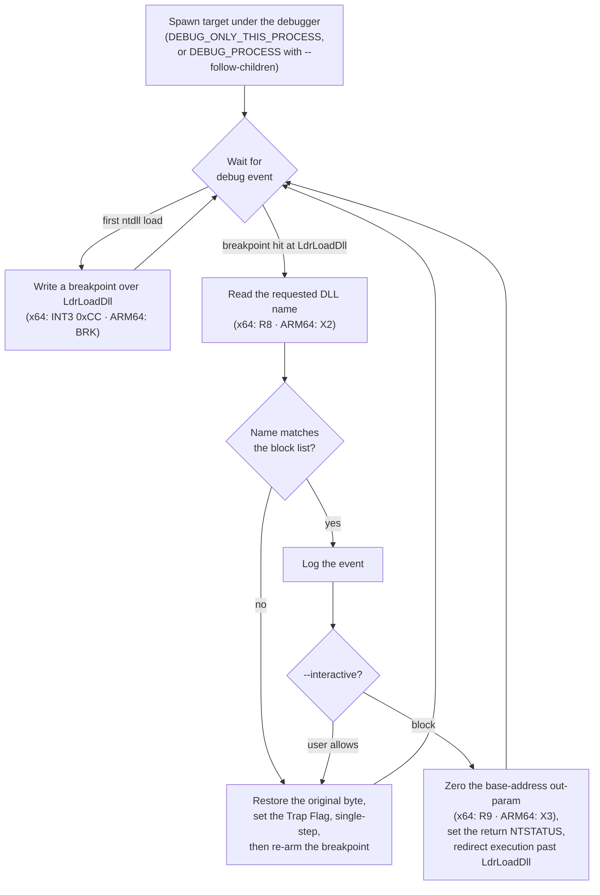

# ObexNet

[](https://github.com/JanusMael/ObexNet/actions/workflows/ci.yml)
[](https://github.com/JanusMael/ObexNet/actions/workflows/release.yml)
[](https://github.com/JanusMael/ObexNet/releases/latest)
[](https://dotnet.microsoft.com/download/dotnet/10.0)

**ObexNet** launches a Windows program under a debugger and stops chosen DLLs from loading into it — at startup or later at runtime. It is built for malware analysis and security research, where you want to spawn a sample with a specific library (for example `amsi.dll` or an EDR/monitoring hook) prevented from ever attaching.

It is a Windows-only console tool written in 100% C#, with no runtime dependencies: the released binary is self-contained and needs no .NET install on the target machine.

> **Origin.** ObexNet began as a C#-port of [dis0rder0x00/obex](https://github.com/dis0rder0x00/obex) (written in C, x64-only) and has since grown its own features — ARM64 support, pattern matching, JSON output, and the modes described under [Beyond the original obex](#beyond-the-original-obex).

> [!IMPORTANT]
> Blocking a DLL means altering how another process starts. Run ObexNet only against processes you are authorized to launch and analyze, on systems you control. It spawns its target under a debugger, so it needs the rights to debug that process; it is an analysis instrument, not a hardening or anti-malware control.

## How it works

ObexNet creates the target process under the Windows debugging API and drives the debug event loop itself. It hooks `ntdll!LdrLoadDll` — the routine every module load funnels through — inspects the DLL each call is about to load, and for anything on the block list rewrites the call's result so the load fails (or, optionally, appears to succeed) before `LdrLoadDll` runs.



When a load is blocked, the return status is set to `STATUS_DLL_NOT_FOUND` (`0xC0000135`) and the module's base-address output is zeroed, so the caller sees a clean "not found". With `--fake-success` the status is set to `STATUS_SUCCESS` instead while the base address is still zeroed — useful against samples that abort when a library (say `amsi.dll`) fails to load, though the handle they receive is null.

The state machine is a faithful recreation of the original obex debug loop:

1. **Wait** for a debug event.
2. On the first `LOAD_DLL_DEBUG_EVENT`, **locate `LdrLoadDll`** and **write a breakpoint** over it (`INT3` on x64, `BRK` on ARM64).
3. On the breakpoint exception, **read the requested DLL name** from the argument register and **check it** against the block list.
4. To **block**, zero the base-address out-parameter, set the return `NTSTATUS`, and point execution at the return address so `LdrLoadDll` never runs.
5. To **allow**, restore the original instruction byte, set the **Trap Flag**, and single-step.
6. On the single-step exception, **re-arm** the breakpoint and continue.

## Requirements

- **Windows**, 64-bit — **x64** or **ARM64**. ObexNet refuses to run on 32-bit processes or non-Windows hosts.
- **To run a prebuilt release:** nothing else. The binary is self-contained.
- **To build from source:** the [.NET 10 SDK](https://dotnet.microsoft.com/download/dotnet/10.0).

## Download

Prebuilt binaries are attached to every [GitHub Release](https://github.com/JanusMael/ObexNet/releases/latest):

| Platform | Architecture | Archive |
|----------|--------------|-----------------------|
| Windows  | x64          | `ObexNet-win-x64.zip` |
| Windows  | ARM64        | `ObexNet-win-arm64.zip` |

Each archive contains a self-contained `ObexNet.exe` together with `LICENSE` and `THIRD-PARTY-NOTICES.md`. The binaries are unsigned, so Windows SmartScreen may prompt on first run.

## Usage

```text
ObexNet.exe "<command>" [patterns] [options]
```

| Argument | Meaning |
|----------|---------|
| `<command>` | The command line to spawn and debug, quoted as one argument — e.g. `"powershell.exe -c whoami"`. |
| `[patterns]` | Optional comma-delimited list of DLLs to block — e.g. `amsi.dll,api-ms-win-*`. Omit it to block the default, `amsi.dll`. |

### Options

| Flag | Effect |
|------|--------|
| `--silent` | Suppress the banner and informational output. Blocked-load notices and warnings still print — for fully machine-readable output use `--json`. |
| `--json` | Emit one JSON object per event (and for errors) instead of human-readable logs. |
| `--interactive` | Prompt `[?] Block loading of '<dll>'? (Y/n)` on each match; the default (Enter) blocks, `n` allows. |
| `--fake-success` | Return `STATUS_SUCCESS` with a null handle instead of `STATUS_DLL_NOT_FOUND` (experimental). |
| `--follow-children` | Also debug child processes the target spawns (experimental). |

An unrecognized `--flag` prints `[!] Unknown flag: <flag>` and exits without running.

### Block-list matching

- Matching is on the **file name** only and is **case-insensitive** (`AMSI.DLL` == `amsi.dll`).
- A pattern containing `*` or `?` is treated as a **glob** — `*` matches any run of characters, `?` matches one. So `api-ms-win-core-*.dll` blocks a whole family of virtual DLLs. Patterns without `*`/`?` match the exact file name; raw regular expressions are **not** accepted.

## Examples

Block the default (`amsi.dll`) while spawning PowerShell:

```shell
ObexNet.exe "powershell.exe -c whoami"
```

Block several DLLs, including a wildcard family:

```shell
ObexNet.exe "malware.exe" "amsi.dll,api-ms-win-core-*.dll"
```

Structured output for a pipeline or SIEM (`--json`):

```shell
ObexNet.exe "powershell.exe -c whoami" amsi.dll --json
```

Each blocked load is one line; the `action` is `block`, or `fake_success` under `--fake-success`:

```json
{"timestamp":"2026-09-05T23:57:27.5252929Z","type":"blocked","target":"amsi.dll","action":"block"}
```

Fatal errors are reported the same way:

```json
{"type":"error","message":"..."}
```

A normal (non-`--json`) run looks like this:

```text
  *
   ____  _                  _   _      _
  / __ \| |                | \ | |    | |
 | |  | | |__   ___ __  __ |  \| | ___| |_
 | |  | | '_ \ / _ \|_\/_| | . ` |/ _ \ __|
 | |__| | |_) |  __/  /\   |  \  |  __/ |_
  \____/|_.__/ \___||_|\_| ,_| \_|\___|\__|

[*] Architecture: X64
[*] Command: 'powershell.exe -c whoami'
[*] Block Patterns: 'amsi.dll'
[*] Options: Silent=False, JSON=False, Interactive=False, FakeSuccess=False, FollowChildren=False
[+] Started process
[+] Hooked LdrLoadDll at 0x7FFE6716EDE0 (ntdll at 0x7FFE67100000)
[+] Blocked loading of 'amsi.dll'
[+] Child exited with code: 0
```

## Beyond the original obex

Features ObexNet adds on top of the original C tool:

- **ARM64 as well as x64** — one binary per architecture, each self-contained.
- **Pattern matching** — comma-delimited block lists with `*`/`?` glob support, so a single pattern can cover an entire `api-ms-win-*` family instead of one DLL at a time.
- **Silent and JSON output** (`--silent`, `--json`) — structured, one-object-per-event logging for automated pipelines and SIEM ingestion.
- **Interactive mode** (`--interactive`) — decide per DLL at the prompt, so you can selectively allow some dependencies and block others to watch how a sample reacts.
- **Fake-success** (`--fake-success`) — return `STATUS_SUCCESS` rather than a not-found error, for samples that bail out when a library fails to load.
- **Child-process following** (`--follow-children`) — attach to processes the target spawns, to trace multi-stage chains (e.g. `powershell.exe` launching `cmd.exe`).

## Building from source

Requires the .NET 10 SDK.

```shell
dotnet build ObexNet.sln
dotnet test ObexNet.sln
```

To produce the release archives locally — the same script CI runs (see [`.github/WORKFLOWS.md`](.github/WORKFLOWS.md)):

```shell
pwsh publish/publish.ps1
```

This publishes a self-contained, single-file, trimmed `ObexNet.exe` per Windows RID and zips each into `dist/`.

### Versioning

Releases use **CalVer** — `vYEAR.QUARTER.MMDD` (e.g. `v2026.3.907` = 2026, Q3, 7 September; add a `-rc.1` suffix for a pre-release). Pushing such a tag stamps the published binary's version through the [`Bennewitz.Ninja.AutoVersioning`](https://www.nuget.org/packages/Bennewitz.Ninja.AutoVersioning) source generator. Local builds fall back to the generator's own CalVer build version, or you can set one with `pwsh publish/publish.ps1 -Version 2026.3.907`.

## License

ObexNet is licensed under the [MIT License](LICENSE).

It began as a C# port of [dis0rder0x00/obex](https://github.com/dis0rder0x00/obex), which is distributed under the BSD 3-Clause License. That project's copyright notice and license are retained in [THIRD-PARTY-NOTICES.md](THIRD-PARTY-NOTICES.md) and are included in every release archive.

## Credits

- Original tool and debug-loop design: [dis0rder0x00/obex](https://github.com/dis0rder0x00/obex).
